# GramSathi — Digital Village Services Platform

A multilingual village e-governance application that brings citizen services, document requests, village announcements, administrative workflows and an AI-assisted help desk into one platform.

**Current implementation:** Python + Starlette REST API, SQLite database, browser-based citizen/admin interface, and a typed TypeScript API client for future React Native / React integrations. This release adds a safer deployment baseline: security response headers, request IDs, database readiness checks, stricter production configuration validation, and a non-root Docker image.

> This repository is a development/demo project. Payment actions are simulated; do not use it to collect real payments or sensitive production citizen records without a formal security, privacy and deployment review.

## Screenshots

### Citizen portal
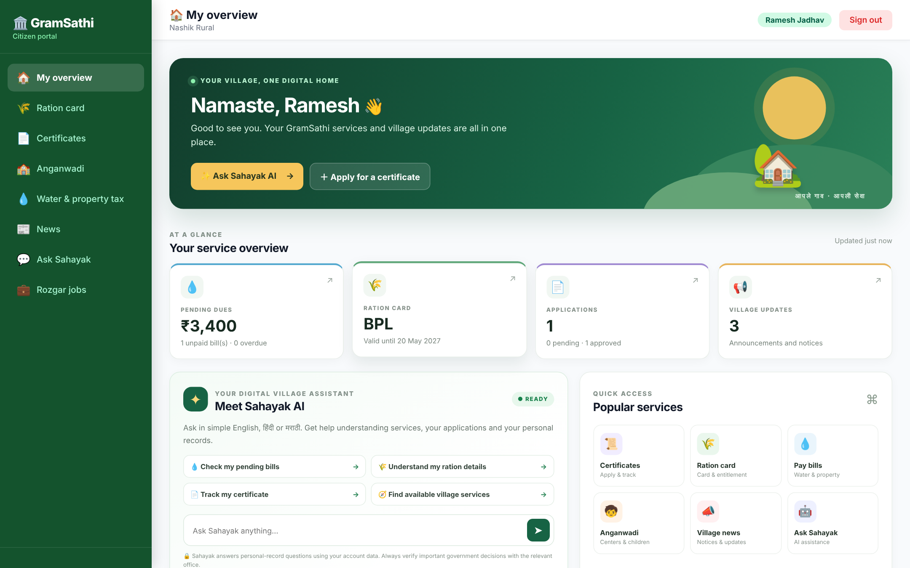

| | |
|---|---|
| 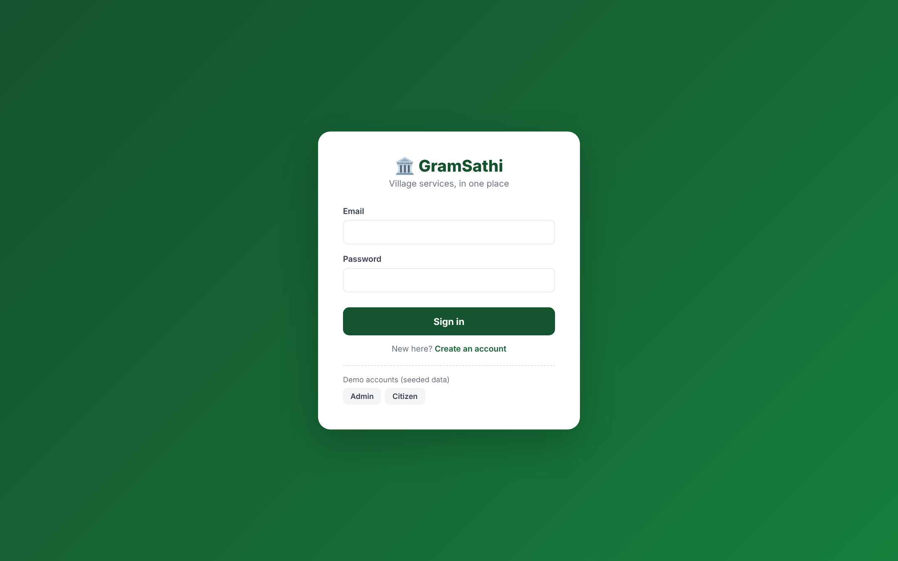<br>**Sign in** | 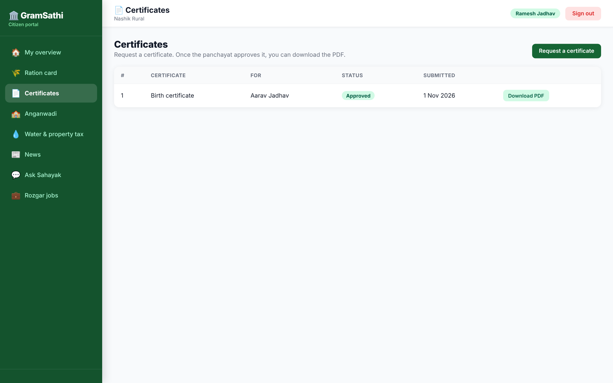<br>**Certificate requests** |
| 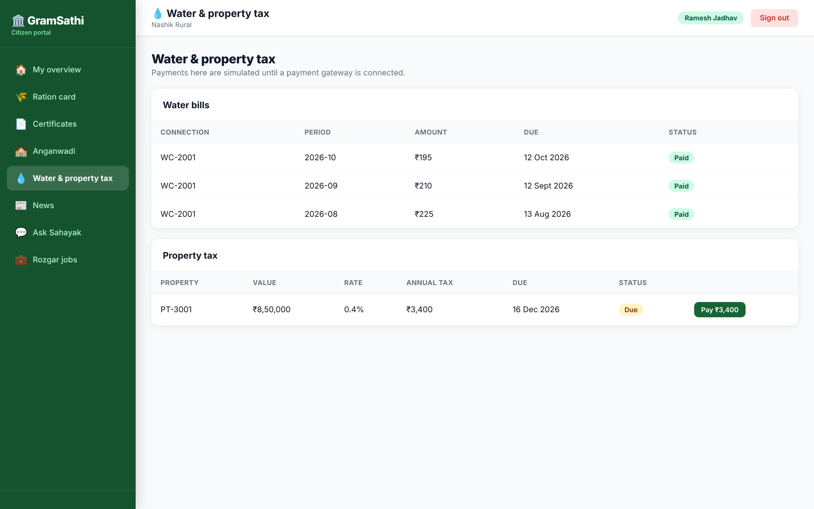<br>**Water & property tax** | 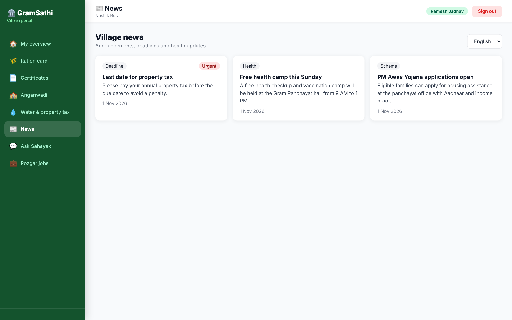<br>**Village news** |
| 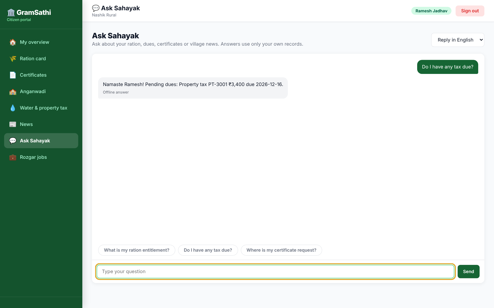<br>**Sahayak AI assistant** | 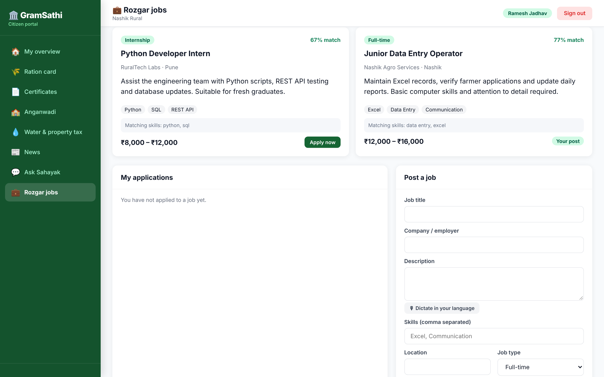<br>**Rozgar jobs with explainable match scores** |

### Admin console
| | |
|---|---|
| 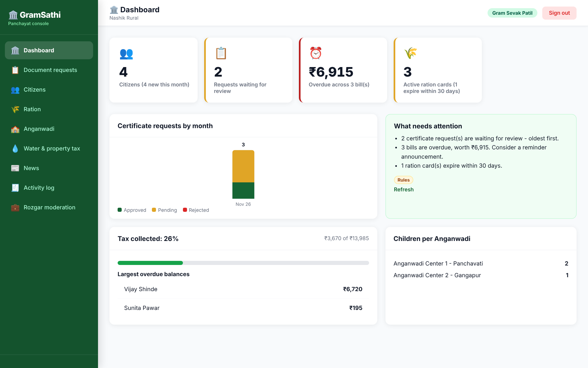<br>**Dashboard** | 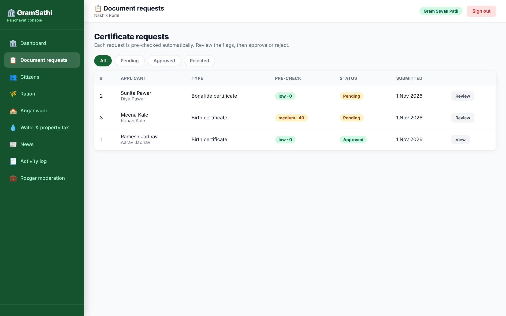<br>**Document requests** |
| 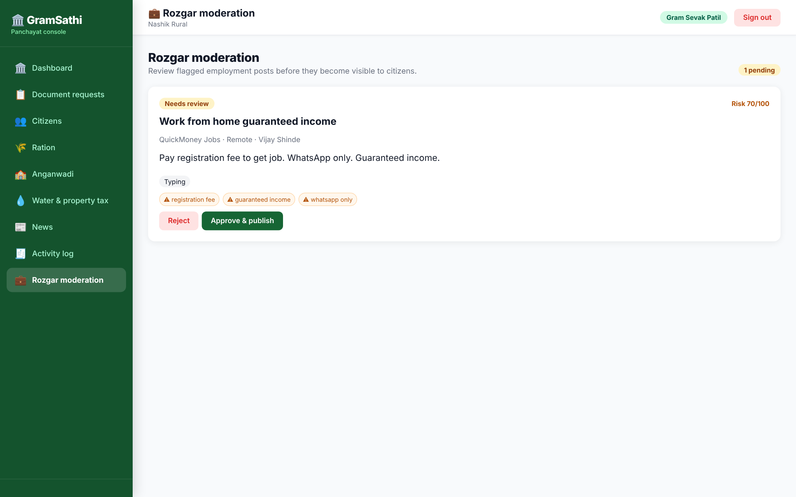<br>**Rozgar scam-risk moderation** | 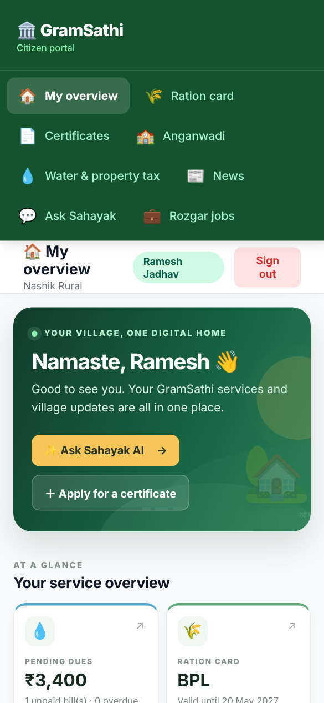<br>**Responsive mobile layout** |

## Features

### Citizen portal
- Citizen registration and login with role-aware access.
- View personal ration, water, property and Anganwadi-related records.
- Submit and track document/certificate requests.
- View village news and announcements.
- Ask the GramSathi Sahayak assistant in English, Hindi or Marathi.
- Explore Rozgar: build a worker/employer profile, browse local jobs, receive explainable skill-match scores, apply with a cover note, and post jobs.
- Employer workflow: review ranked applicants and update application status.
- Safety workflow: suspicious job posts are held for admin moderation using transparent keyword rules; browser speech-to-text is available for profile/job descriptions where supported.
- View eligible approved documents as PDFs.

### Admin console
- Dashboard summaries and administrative insights.
- Review document requests and approve/reject workflows.
- Manage users and village service records.
- Publish and manage announcements.
- Review audit events.
- Moderate flagged Rozgar job posts before publication.
- Generate AI-assisted news drafts and document pre-check summaries.

### Rozgar employment marketplace
- Worker profile with skills, education, experience, preferred location and short bio.
- Job search, skill-overlap match score with explanation, and application tracking.
- Employer job posting, applicant ranking, and shortlist/reject/hire status updates.
- Keyword-based scam-risk screening and admin approval queue.
- Sample data includes two published roles and one flagged demo post.

### Engineering features
- Parameterised SQL queries, relational constraints and indexes.
- Password hashing, signed JWT authentication and role-based permissions.
- Ownership checks for citizen records.
- Audit logging for selected administrative/payment actions.
- Optional Anthropic integration with deterministic rule-based fallback.
- Automated API tests and Docker support.

## Technology stack

| Layer | Technology |
|---|---|
| Backend | Python 3.11+, Starlette, Pydantic |
| Database | SQLite, SQL |
| Authentication | JWT (HS256), scrypt password hashing |
| Frontend | HTML, CSS, vanilla JavaScript |
| API | REST / JSON |
| Runtime hardening | Security headers, request correlation IDs, readiness endpoint |
| PDF | ReportLab |
| Optional AI | Anthropic API; rule-based fallback without a key |
| Tests | pytest, Starlette TestClient / httpx |
| Container | Docker, Docker Compose |

## Repository structure

```text
GramSathi-v2/
├── backend/
│   ├── app/
│   │   ├── routes/          # auth, documents, news, services, admin, assistant
│   │   ├── schema.sql       # relational schema, constraints and indexes
│   │   ├── ai.py             # AI workflows and rule-based fallback
│   │   ├── security.py       # password hashing and token helpers
│   │   ├── db.py             # database access
│   │   └── asgi.py           # ASGI entry point
│   ├── tests/                # automated API tests
│   ├── .env.example
│   ├── requirements.txt
│   └── Dockerfile
├── web/                      # citizen portal and admin console
├── clients/                  # typed TypeScript API client
├── docs/screenshots/         # README screenshots
├── docker-compose.yml
└── README.md
```

## Run locally on Windows

### 1. Prerequisites

- Python 3.11 or newer
- Git
- VS Code (recommended)

### 2. Clone the repository

```powershell
git clone https://github.com/devs901/GramSathi-v2.git
cd GramSathi-v2
```

If you downloaded the ZIP instead, extract it and open the extracted `GramSathi-v2` folder in VS Code.

### 3. Create and activate a virtual environment

```powershell
cd backend
py -m venv .venv
.venv\Scripts\activate
```

### 4. Install dependencies

```powershell
python -m pip install --upgrade pip
pip install -r requirements.txt
```

### 5. Configure environment (optional for local demo)

```powershell
copy .env.example .env
```

The default development configuration uses demo data on an empty database. The app works without an AI API key using its built-in rule-based responses. If you add an Anthropic key, put it only in `backend/.env`; never commit that file.

### 6. Start the server

Run from the `backend` directory:

```powershell
uvicorn app.asgi:app --reload --port 8000
```

Open **http://127.0.0.1:8000** in your browser. Check `http://127.0.0.1:8000/api/health` for liveness and `/api/ready` for database readiness.

### Demo accounts

| Role | Email | Password |
|---|---|---|
| Admin | `admin@gramsathi.in` | `Admin@1234` |
| Citizen | `ramesh@example.com` | `Citizen@1234` |

These are public demo credentials for local testing only. Do not use them in a deployed environment. For a real deployment, disable demo seeding and create a unique administrator account.

## Run tests

From the `backend` directory, with the virtual environment active:

```powershell
python -m pytest -q
```

The included test suite currently passes **34 tests** (core API plus Rozgar jobs, matching, moderation and AI-fallback tests).

## Docker

From the repository root, create a `.env` file containing a strong secret before starting production-mode Compose:

```env
SECRET_KEY=replace-with-a-random-secret-at-least-32-characters
CORS_ORIGINS=http://localhost:8000
```

Then run:

```powershell
docker compose up --build
```

The database is stored in the named `gs_data` volume. Keep that volume backed up. For production, configure HTTPS, a persistent database volume, restricted CORS origins, secret management, monitoring and backups.

## API overview

All API routes are under `/api`. After login, send the returned token as `Authorization: Bearer <token>`.

| Area | Main routes |
|---|---|
| Authentication | `POST /api/auth/register`, `POST /api/auth/login`, `GET/PATCH /api/auth/me` |
| Documents | `/api/documents` and document review/PDF routes |
| News | `/api/news`, `/api/ai/news-draft` |
| Citizen records | `/api/me/ration`, `/api/me/water`, `/api/me/property`, `/api/me/anganwadi` |
| AI assistant | `/api/ai/chat`, `/api/ai/chat/history` |
| Rozgar | `/api/rozgar/profile`, `/api/rozgar/jobs`, `/api/rozgar/applications/mine` and job application/applicant routes |
| Rozgar moderation | `/api/admin/rozgar/moderation`, `/api/admin/rozgar/jobs/{id}/moderate`; AI drafts: `/api/ai/rozgar/profile-draft`, `/api/ai/rozgar/job-draft`, `/api/ai/rozgar/cover-draft` |
| Admin | `/api/admin/dashboard`, `/api/admin/audit`, `/api/admin/users` |

See `backend/app/routes/` for the implemented request handlers and `clients/gramsathi-api.ts` for the TypeScript client. Rozgar matching is a transparent rules-based skill-overlap score, not an AI hiring decision. Scam screening is heuristic and cannot guarantee fraud detection. Browser voice input depends on Chrome/Web Speech API support and microphone permissions.

## Database and security notes

- The schema is defined in `backend/app/schema.sql` and uses relational constraints and indexes.
- SQL values are parameterised in the application code.
- Passwords are stored as hashes, not plaintext.
- Citizen record access is scoped to the authenticated user.
- Admin and citizen permissions are separated by role.
- AI features have a rule-based fallback when no API key is configured or the external call fails.

Before a public deployment, conduct an independent security review, add production-grade monitoring and backups, review privacy/legal requirements for citizen data, and replace demo credentials and development settings.

## Production deployment checklist

This repository is a hardened deployment baseline, **not a certification that the application is production-ready for real citizen data**. Before public launch:

1. Provision a managed PostgreSQL database and implement/test a migration from SQLite (the current application data layer is SQLite-specific).
2. Put the API behind a TLS-terminating reverse proxy/load balancer; configure exact HTTPS CORS origins and host allow-lists.
3. Store `SECRET_KEY` and AI credentials in a cloud secret manager; rotate any credential that may have been exposed.
4. Disable demo seeding (`SEED_DEMO_DATA=false`) and create a unique administrator account through a reviewed provisioning process.
5. Add shared rate limiting (for example Redis), login throttling, account recovery and MFA before exposing authentication publicly.
6. Configure encrypted automated backups, restore drills, monitoring, alerting and centralized redacted logs.
7. Complete an independent security/privacy review, authorization testing, dependency scanning and accessibility review.
8. Integrate a real payment provider only after legal/compliance review; current payment flows are simulations.

The API now provides `GET /api/ready` for database readiness and adds security headers plus an `X-Request-ID` response header. Docker runs as a non-root user and includes a readiness health check. Rozgar includes optional AI-assisted profile/job/cover-note drafts, each with a deterministic rules fallback; applicant summaries and match explanations remain rules-based.

## Known limitations

- Water/property payment flows are simulated; no real payment gateway is connected.
- SQLite is used for the demo. A production migration to PostgreSQL or MySQL requires database compatibility work and testing.
- The in-memory rate limiter is not shared between multiple server processes; use a shared store such as Redis for a multi-instance deployment.
- AI responses are optional and depend on external API availability/configuration.
- Rozgar skill scores are simple overlap indicators and must not be used as automatic hiring decisions. Scam detection is heuristic and cannot guarantee that every fraudulent post is caught. Contact sharing is not enabled in this demo. Browser voice input relies on Web Speech API support and microphone permission.
- No hosted live demo is provided by this repository yet.

## Roadmap

- PostgreSQL/MySQL deployment profile and migrations.
- Production-grade rate limiting and observability.
- Real payment gateway integration with verified webhooks.
- Stronger account recovery and multi-factor authentication.
- Accessibility and end-to-end browser tests.
- Mobile app integration using the typed TypeScript API client.

## Author

**Devendra Rathod**  
AI & Data Science Graduate | Python Developer | Data Analyst  
GitHub: [@devs901](https://github.com/devs901)

## License

MIT — see [LICENSE](LICENSE).

## Citizen home experience (UI update)

The citizen home page includes a personalized service overview, Sahayak AI prompt shortcuts, quick links to core services, village announcements, and a citizen safety reminder. The AI prompt shortcuts use the existing `/api/ai/chat` endpoint and preserve the configured English/Hindi/Marathi assistant flow. AI availability and answer quality depend on the backend assistant configuration; the home screen does not claim that an external AI provider is connected unless configured.
